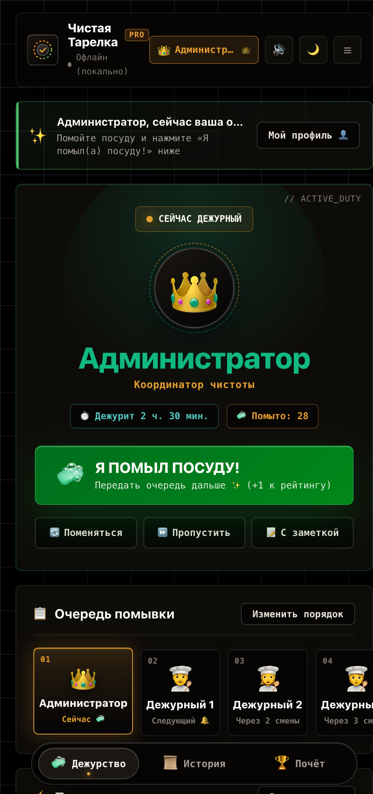
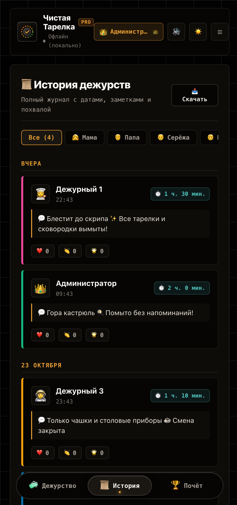
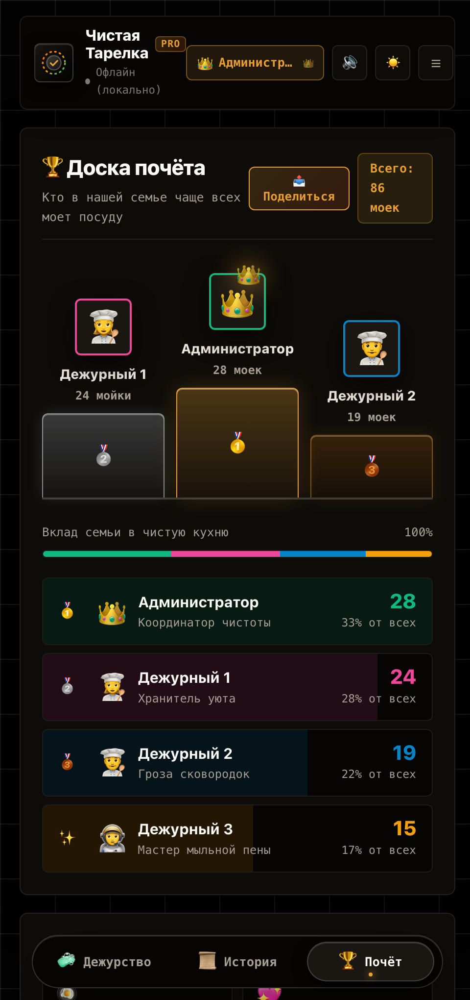
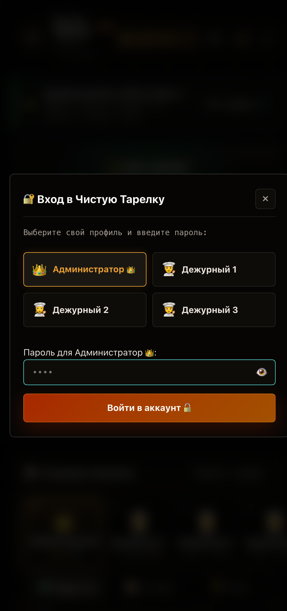

<div align="center">

[🇷🇺 Русский](README.md) • [🇬🇧 English](README.en.md)

# 🍽️ Clean Plate PRO

**A delightful kitchen duty tracker that turns a chore into a game.**  
*Apple VisionOS aesthetic, 3D podium, family reactions, and a rock-solid turn queue — built for families and shared flats.*

[](LICENSE)
[](https://developer.apple.com/pwa/)
[](https://developer.mozilla.org)
[](https://python.org)
[](https://cloudflare.com)
[](https://raspberrypi.com)

[✨ Features](#-key-features) • [📸 Screenshots](#-interface--design) • [🧩 App Tour](#-how-it-works) • [🚀 Quick Start](#-self-hosting-at-home) • [☁️ Cloud & Tunnels](#-internet-synchronization) • [⚙️ Customization](#️-configuring-members--roles) • [🔌 REST API](#-rest-api-reference)

</div>

---

> 💬 **We've all been there:** a kitchen sink piled high with pans, and everyone claiming they "just did the dishes yesterday".  
> **Clean Plate PRO** settles that friendly debate with style, transparency, and good energy. No heavy frameworks, no ads, no monthly fees. Just pure vanilla web craft, smooth animations, procedural audio feedback, and a 3D leaderboard for the home.

---

## 📸 Interface & Design

<div align="center">

| 🧼 1. Duty Hero View | 📜 2. Interactive Timeline | 🏆 3. Honor Board & Stats |
|:---:|:---:|:---:|
|  |  |  |
| *Live shift timer, glowing aura badge, quick swaps, and interactive queue stepper* | *Day-by-day groupings, wash notes, ❤️👏🌟 reactions, and one-click CSV export* | *3D glass podium, 100% share breakdown, awards, and instant Telegram digest* |

<br />



*Sign in by choosing your avatar and entering a quick 4-digit PIN. Frictionless, secure, and password-free.*

</div>

---

## ✨ Key Features

- 🪟 **Apple VisionOS & Glassmorphism Aesthetic**: Floating Island bottom navigation, blurred backdrops, rich OKLCH color space, and a glowing neon aura for the active duty member.
- ⚡ **Zero Dependencies (0 npm packages)**: Built with pure Vanilla JavaScript and semantic modern CSS3. No React, no build steps, no bundle bloat. The entire app weighs just a few kilobytes and launches instantly on any phone or tablet.
- 🔄 **Micro-Diffing & ETag 304 Caching**: Incremental DOM updates without UI flickers. The local server answers poll requests in sub-milliseconds with `304 Not Modified`, sending **0 payload bytes** when idle.
- 🔊 **Procedural Web Audio Synthesizer**: Haptic switch clicks, bubbly pops, and a triumphant major chord (C5–E5–G5–C6) synthesized in real-time in the browser without loading heavy audio assets.
- 📱 **True PWA with Offline Support**: Installable on iOS Safari and Android Chrome as a native fullscreen app without browser chrome. Service Worker caches all assets for instant offline booting.
- ☀️ **Screen Wake Lock**: Prevents the screen from turning off — perfect for a kitchen tablet or an old phone mounted on the wall or fridge.
- 🔐 **Family Roles & PIN Protection**: Guests and housemates can view history and stats; completing a shift or rearranging the queue requires the active washer's or Admin's PIN.
- ☁️ **Hybrid Sync Options**: Run 100% locally over home Wi-Fi (Raspberry Pi, mini PC, Docker) or connect to free serverless cloud storage (Cloudflare Workers KV or Google Firebase) to sync across 4G/5G mobile networks worldwide.
- 📊 **One-Click Family Digest & CSV Export**: Generate a formatted Markdown recap with emoji medals for Telegram or WhatsApp with one tap, or download the complete history as a CSV spreadsheet.

---

## 🧩 How It Works

### 1. 🧼 Tab 1: Duty Hero View
The primary mission-control screen:
- **Duty Hero Card**: Personal profile hue, glowing active ring, avatar, and name of whoever is currently up.
- **Dynamic Shift Timer**: Automatically tracks how long the current duty has been active (`⏱️ On duty for 2 h. 30 m.`).
- **Experience Counter**: Total number of washes completed across all time.
- **The Big "I WASHED THE DISHES!" Button**: Tactile glassmorphism button with haptic feedback. Tapping triggers fullscreen confetti, plays a victory chord, and passes the baton to the next person.
- **Quick Turn Modifiers**:
  - `🔄 Swap`: Hand over the current shift to someone else in one tap without disrupting the queue order.
  - `⏩ Skip`: Emergency pass (e.g., if a housemate is sick or traveling).
  - `📝 Add Note`: Attach context to a wash using pre-made chips (*"Pots & pans mountain 🍳"*, *"Squeaky clean ✨"*, *"After dinner party 🍰"*, *"Washed without reminders! 🌟"*).
- **Interactive Queue Stepper**: Visual roadmap of who's up next (*"Now 🧼"*, *"Next 🔔"*, *"In 2 shifts"*). The **"Change order"** button opens a modal to adjust positions with up/down arrows.
- **Recent Activity Glance**: At-a-glance summary of the most recent completed wash right on the home view.

---

### 2. 📜 Tab 2: Timeline Journal
A chronological log of all completed chores:
- **Grouped by Calendar Day**: Washes are automatically structured into clean daily sections (*"Today"*, *"Yesterday"*, *"October 24"*, etc.).
- **Rich Cards**: Completion timestamp, shift duration, avatar, and attached notes.
- **Family Reactions (❤️, 👏, 🌟)**: Peer praise that syncs across all screens. Send some love or applaud someone for tackling a tough greasy pan.
- **Filter Chips**: Filter by a specific housemate in one click or view the full shared stream.
- **CSV Export**: The **"📥 Export"** button generates `dish_duty_history.csv` with dates, names, shift durations, and notes for Excel or Google Sheets.

---

### 3. 🏆 Tab 3: Honor Board & 3D Podium
Friendly gamification and shared contribution:
- **3D Glass Podium**: Three-dimensional frosted glass pedestals for the top 3 washers, complete with gold, silver, and bronze badges, floating avatars, and a winner's crown.
- **Contribution Share Bar**: Segmented progress bar showing each person's percentage share of all washed dishes (totaling 100%).
- **Detailed Leaderboard**: Roster ranked by wash counts and contribution share.
- **Fun Honorary Awards**:
  - 🍳 *"Pan Slayer"* — most total washes.
  - ❤️ *"Kitchen Favorite"* — most reactions collected.
  - 🧼 *"Bubble Master"* — most active washer of the week.
  - 🦉 *"Night Patrol"* — for closing out shifts late in the evening.
- **Telegram / WhatsApp Digest**: Tap **"📤 Share"** to copy a formatted summary with emoji medals:
  ```text
  🍽️ CLEAN PLATE PRO • LEADERBOARD
  ━━━━━━━━━━━━━━━━━━━━━
  🧼 Currently on duty: Admin 👑
  📊 Total washes: 86 times

  🏆 HONOR BOARD:
  🥇 Admin: 28 washes (33%)
  🥈 Member 1: 24 washes (28%)
  🥉 Member 2: 19 washes (22%)
  ✨ Member 3: 15 washes (17%)
  ━━━━━━━━━━━━━━━━━━━━━
  📱 Live Tracker: http://192.168.1.75:8080
  ```

---

### 4. ⚙️ Settings, Network & Backups
Accessible via the hamburger menu **☰** in the top right corner:
- **Access Status**: Displays your current permission level (Guest / Member / Admin). Entering your PIN unlocks full editing.
- **Local Wi-Fi IP**: Shows the server's local address (e.g. `http://192.168.1.75:8080`) with a one-tap copy button for other devices in the house.
- **Cloud Sync URL**: Input field for your external database (Firebase Realtime DB or Cloudflare Worker) with a live connection dot.
- **JSON Backup & Restore**:
  - `📥 Export Backup (JSON)`: Download a full snapshot of all settings, accounts, queue order, and history.
  - `📤 Restore from File`: Instantly migrate your data to a new server or phone.
- **Danger Zone**: Password-guarded reset with confirmation.

---

## 🚀 Self-Hosting at Home

The server backend is engineered for minimal resource usage. It runs entirely on the Python or Node.js standard library (no `pip install`, zero external packages), keeps state in RAM for instant reads, and protects MicroSD cards on Raspberry Pi by using atomic writes.

### Architecture Highlights:
- **RAM State Cache**: `GET /api/state` requests are served straight from memory with zero disk I/O.
- **ETag & 304 Not Modified**: If no dishes were washed since the last check, the server returns an empty `304` in **< 1 ms**, transferring **0 bytes** of body payload.
- **On-the-Fly Gzip**: Compresses HTML, JS, CSS, and JSON automatically, saving bandwidth on mobile connections.
- **Atomic Disk Writes**: Persisting to `data.json` writes to a temporary file first before replacing, protected by a mutex lock (`threading.Lock`), preventing database corruption during unexpected power outages.

---

### Option 1: Raspberry Pi / Linux (Systemd Service 24/7)

The recommended setup for a home microcomputer — runs continuously and recovers automatically after power loss.

#### 1. Clone the repository
```bash
cd ~
git clone https://github.com/your-username/dish-tracker.git
cd dish-tracker
```

#### 2. Test manual start
```bash
python3 server.py
# Server starts on http://0.0.0.0:8080
```

#### 3. Set up Systemd auto-start
Create the service unit file:
```bash
sudo nano /etc/systemd/system/dish-tracker.service
```

Paste the following configuration (replace `pi` with your Linux username if different):

```ini
[Unit]
Description=Dish Tracker PRO - Smart Duty Tracker
After=network.target

[Service]
Type=simple
User=pi
WorkingDirectory=/home/pi/dish-tracker
ExecStart=/usr/bin/python3 /home/pi/dish-tracker/server.py
Restart=always
RestartSec=3
Environment=PORT=8080

[Install]
WantedBy=multi-user.target
```

Enable and start the service:
```bash
# Reload systemd definitions
sudo systemctl daemon-reload

# Enable launch on boot
sudo systemctl enable dish-tracker

# Start the service right now
sudo systemctl start dish-tracker

# Check operational status
sudo systemctl status dish-tracker
```

#### Useful management commands:
```bash
# Stream live logs
journalctl -u dish-tracker -f

# Restart the server
sudo systemctl restart dish-tracker

# Stop the server
sudo systemctl stop dish-tracker
```

---

### Option 2: Fast SSH Deploy with `deploy-to-rpi.sh`

If you develop on a laptop (macOS / Linux / Windows), deploy updates to your Raspberry Pi in seconds:

```bash
# Run from the project root on your laptop:
./deploy-to-rpi.sh
```

This archives the codebase, transfers it over SSH, and restarts the systemd service in one go.

---

### Option 3: Node.js Server (`server.js`)

If Node.js is already running on your machine:

```bash
# Default launch on port 8080
node server.js

# Custom port
PORT=3000 node server.js
```

---

### Option 4: macOS Quick Launcher

On Apple Mac computers, simply double-click:
- **`Запустить_График.command`**

It starts the server in the background, detects your local Wi-Fi IP address, and opens your browser.

---

### Option 5: Docker & Docker Compose

Ready-to-use container configurations are included:

#### `Dockerfile`:
```dockerfile
FROM python:3.11-alpine
WORKDIR /app
COPY . /app
EXPOSE 8080
ENV PORT=8080
CMD ["python3", "server.py"]
```

#### `docker-compose.yml`:
```yaml
version: '3.8'

services:
  dish-tracker:
    build: .
    container_name: dish-tracker
    restart: unless-stopped
    ports:
      - "8080:8080"
    volumes:
      - ./data.json:/app/data.json
    environment:
      - PORT=8080
```

Start the container:
```bash
docker compose up -d
```

---

## ☁️ Internet Synchronization

To sync shift updates across all phones when away from home Wi-Fi (over mobile 4G/5G anywhere in the world), pick the solution that suits your setup best:

```text
                  ┌─────────────────────────────────────────┐
                  │         FAMILY & TEAM DEVICES           │
                  │   (iOS Safari PWA / Android Chrome)     │
                  └────────────────────┬────────────────────┘
                                       │
                 ┌─────────────────────┴─────────────────────┐
                 ▼                                           ▼
       [ OPTION 1: SERVERLESS ]                    [ OPTION 2: HOMELAB ]
         Free Cloud Storage                   Self-Hosted (Raspberry Pi/Linux)
                 │                                           │
       ┌─────────┴─────────┐                 ┌───────────────┼───────────────┐
       ▼                   ▼                 ▼               ▼               ▼
 Firebase RTDB      Cloudflare Worker   Cloudflared     Tailscale VPN       Ngrok
 (Google Cloud)     (Edge Key-Value)    (Custom Domain) (WireGuard Mesh)  (30s Preview)
```

---

### 🌟 Option A: Firebase Realtime Database (Easiest, 100% Free)

No public IP, router configuration, or 24/7 home server required.

1. Open [Google Firebase Console](https://console.firebase.google.com/) with your Google account.
2. Click **"Create a project"** (e.g. `dish-tracker`).
3. In the left navigation, open **"Build"** ➔ **"Realtime Database"** and click **"Create Database"**.
4. Choose your closest region (e.g. *europe-west1*).
5. Switch to the **"Rules"** tab and paste:
   ```json
   {
     "rules": {
       ".read": true,
       ".write": true
     }
   }
   ```
   Click **"Publish"**.
6. In the **"Data"** tab, copy your database URL:
   ```text
   https://your-project-default-rtdb.europe-west1.firebasedatabase.app/
   ```
7. Open **Clean Plate PRO**, click **Settings (☰)**, paste the URL into **"Cloud Sync"**, and save.

*The top status indicator will switch to "In Cloud 🟢", and all devices will sync instantly.*

---

### ⚡ Option B: Cloudflare Workers + KV (Global Edge, No Blocks)

A reliable serverless solution. Cloudflare offers 100,000 free requests per day.

Included files:
- `cloudflare-worker.js` / `worker.js`
- `wrangler.toml`

#### Deploy via the Cloudflare Dashboard:
1. Sign up for free at [cloudflare.com](https://cloudflare.com).
2. In the sidebar, go to **"Workers & Pages"** ➔ **"Create application"** ➔ **"Create Worker"**.
3. Name it (e.g. `dish-sync`) and click **"Deploy"**.
4. Click **"Edit code"**, replace the default template with the content of [`cloudflare-worker.js`](cloudflare-worker.js), and click **"Deploy"**.
5. Go to worker **"Settings"** ➔ **"Variables"** ➔ **"KV Namespace Bindings"**.
6. Create a KV namespace named `DISH_KV` and bind it to variable `DISH_KV`.
7. Copy your worker endpoint (`https://dish-sync.your-subdomain.workers.dev`) and paste it into the tracker's Cloud Sync settings.

---

### 🛡️ Option C: Access Your Home Server with Cloudflare Tunnel

If your tracker runs at home on a Raspberry Pi and you want to open it on your own custom domain with free HTTPS:

1. Install the agent on your Raspberry Pi:
   ```bash
   curl -L --output cloudflared.deb https://github.com/cloudflare/cloudflared/releases/latest/download/cloudflared-linux-arm64.deb
   sudo dpkg -i cloudflared.deb
   ```
2. Log in to Cloudflare:
   ```bash
   cloudflared tunnel login
   ```
3. Create a persistent tunnel to port 8080:
   ```bash
   cloudflared tunnel create dish-tunnel
   cloudflared tunnel route dns dish-tunnel dishes.yourdomain.com
   cloudflared tunnel run --url http://localhost:8080 dish-tunnel
   ```
4. Access the server at `https://dishes.yourdomain.com` without port forwarding or a static public IP.

---

### 🔒 Option D: Private Mesh Network with Tailscale (WireGuard)

The most private homelab option: zero ports opened to the public internet, end-to-end encrypted.

1. **On the server (Raspberry Pi / Linux):**
   ```bash
   curl -fsSL https://tailscale.com/install.sh | sh
   sudo tailscale up
   ```
2. **On phones and tablets:**
   - Install **Tailscale** ([iOS App Store](https://apps.apple.com/app/tailscale/id1470499037) / [Google Play](https://play.google.com/store/apps/details?id=com.tailscale.ipn)).
   - Sign in with the same account.
3. **Open the app:** Access the server via MagicDNS (e.g. `http://dish-pi:8080`) or its Tailscale IP (`http://100.x.y.z:8080`).

---

### ⚡ Option E: Express Access with Ngrok (30-Second Preview)

Need a quick temporary HTTPS link to test on mobile data?

1. Install Ngrok:
   - **Linux / Raspberry Pi**:
     ```bash
     curl -s https://ngrok-agent.s3.amazonaws.com/ngrok.asc | sudo tee /etc/apt/trusted.gpg.d/ngrok.asc >/dev/null
     echo "deb https://ngrok-agent.s3.amazonaws.com buster main" | sudo tee /etc/apt/sources.list.d/ngrok.list
     sudo apt update && sudo apt install ngrok
     ```
   - **macOS**: `brew install ngrok/ngrok/ngrok`
2. Add your auth token from [ngrok.com](https://ngrok.com):
   ```bash
   ngrok config add-authtoken YOUR_AUTHTOKEN
   ```
3. Expose port 8080:
   ```bash
   ngrok http 8080
   ```
   Open the generated `https://xxxx.ngrok-free.app` URL directly on your phone and add to Home Screen.

---

### 🌐 Option F: Static Web Hosting (Vercel / GitHub Pages)

If you use a cloud database (Firebase or Cloudflare KV), host the static frontend on free platforms:

#### Deploy to Vercel (one command):
```bash
npx vercel
```
*The included `vercel.json` already contains cache headers tuned for PWA.*

#### Deploy to GitHub Pages:
1. In your GitHub repository, open **Settings** ➔ **Pages**.
2. Under **Build and deployment**, choose branch `main` and folder `/root`.
3. Save — your app will be live at `https://your-username.github.io/dish-tracker/`.

---

## ⚙️ Configuring Members & Roles

There are no hardcoded restrictions on names or team size. You can easily adapt the member roster, avatars, theme colors, and PIN codes.

### 1. Configure Accounts in `server.py` and `server.js`:

Edit the `ACCOUNTS` dictionary:

```python
ACCOUNTS = {
    "admin": {
        "username": "admin",
        "password": "ADMIN_4_DIGIT_PIN",
        "name": "Admin",
        "role": "admin",           # Full permissions (reordering, reset, skips)
        "avatar": "👑"
    },
    "user1": {
        "username": "user1",
        "password": "USER_1_PIN",
        "name": "Alex",
        "role": "member",          # Standard duty member
        "avatar": "👨‍🍳"
    },
    "user2": {
        "username": "user2",
        "password": "USER_2_PIN",
        "name": "Sam",
        "role": "member",
        "avatar": "👩‍🍳"
    },
    "user3": {
        "username": "user3",
        "password": "USER_3_PIN",
        "name": "Jordan",
        "role": "member",
        "avatar": "🧑‍🍳"
    }
}
```

### 2. Initial State and Colors in `data.json`:

```json
{
  "members": {
    "admin": {
      "id": "admin",
      "name": "Admin",
      "role": "Coordinator",
      "avatar": "👑",
      "color": "#10b981",
      "title": "Cleanliness Captain"
    },
    "user1": {
      "id": "user1",
      "name": "Alex",
      "role": "Member",
      "avatar": "👨‍🍳",
      "color": "#f97316",
      "title": "Cozy Keeper"
    },
    "user2": {
      "id": "user2",
      "name": "Sam",
      "role": "Member",
      "avatar": "👩‍🍳",
      "color": "#06b6d4",
      "title": "Pan Slayer"
    },
    "user3": {
      "id": "user3",
      "name": "Jordan",
      "role": "Member",
      "avatar": "🧑‍🍳",
      "color": "#eab308",
      "title": "Bubble Master"
    }
  },
  "queue": ["admin", "user1", "user2", "user3"],
  "currentQueueIndex": 0,
  "dutyStartedAt": 0,
  "stats": { "admin": 0, "user1": 0, "user2": 0, "user3": 0 },
  "history": []
}
```

---

## 🔌 REST API Reference

The server exposes a clean, high-speed HTTP interface:

| Method | Endpoint | Description | Details |
|:---:|:---|:---|:---|
| `GET` | `/api/state` | Returns the current master state | Supports `If-None-Match` header and returns `304 Not Modified` when unchanged |
| `GET` | `/api/version` | Lightweight version poll (30 bytes) | Returns state version timestamp and ETag |
| `POST` | `/api/login` | Validates credentials and returns session token | Uses SHA-256 token hashing |
| `POST` | `/api/state` | Updates duty queue, marks wash, or logs reaction | Requires `X-Auth-User` and `X-Auth-Token` headers |
| `GET` | `/api/events` | Server-Sent Events (SSE) real-time stream | Available on the Node.js implementation (`server.js`) |

---

## 📂 Repository Structure

```text
dish-tracker/
├── index.html               # Main PWA layout (VisionOS Dock, Tab views, Modals)
├── style.css                # Style system (OKLCH palette, glassmorphism, responsive)
├── app.js                   # Client engine (Micro-diffing, Web Audio, roles, sync)
├── sw.js                    # Service Worker (offline caching and fast bootstrap)
├── manifest.json            # PWA manifest (fullscreen display, icons, brand theme)
│
├── server.py                # High-efficiency Python 3 server (RAM cache, ETag 304, Gzip)
├── server.js                # Alternative Node.js server (SSE, In-Memory, ETag)
├── data.json                # Local JSON state storage
├── Dockerfile               # Alpine Python 3.11 container definition
├── docker-compose.yml       # One-command containerized deployment
│
├── cloudflare-worker.js     # Serverless Cloudflare Workers KV script
├── worker.js                # Additional worker adapter
├── wrangler.toml            # Cloudflare Wrangler CLI configuration
├── vercel.json              # Vercel deployment routing and cache rules
├── render.yaml              # Render.com deployment manifest
│
├── dish-tracker.service     # Linux / Raspberry Pi Systemd unit file
├── deploy-to-rpi.sh         # Instant SSH deployment script
├── Запустить_График.command # One-click launcher for macOS users
│
├── icons/                   # Vector and bitmap PWA icon assets
│   ├── icon.svg
│   ├── icon-192.png
│   └── icon-512.png
└── docs/
    └── screenshots/         # Official interface screenshots
        ├── hero-duty-view.png
        ├── history-timeline.png
        ├── podium-stats.png
        └── auth-modal.png
```

---

## 🛠️ Local Development & Testing

```bash
# Clone the repository
git clone https://github.com/your-username/dish-tracker.git
cd dish-tracker

# Launch the local Python 3 server
python3 server.py
```

Open [http://localhost:8080](http://localhost:8080) in your browser.

### Verifying Offline PWA Mode:
1. Open Chrome or Safari DevTools (`F12` or `Cmd+Option+I` ➔ **Application** tab ➔ **Service Workers**).
2. Check the **Offline** checkbox.
3. Refresh the page — the app boots immediately from offline cache.

---

## 📄 License

Distributed under the open-source [MIT](LICENSE) license. Feel free to use, modify, and deploy for your home, roommates, or team.

<div align="center">

**Clean Plate PRO** — turning kitchen duty into peace of mind. ✨🍽️

</div>
